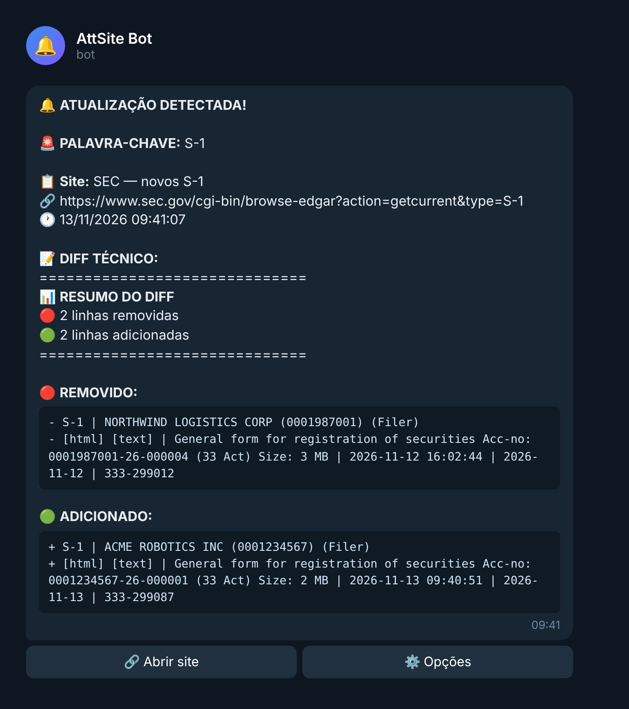
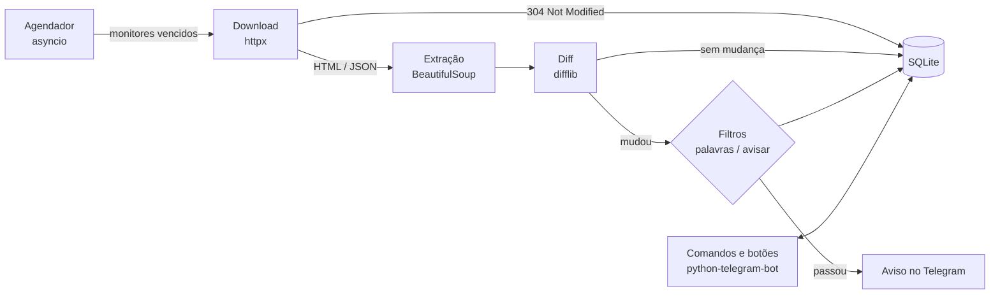

# AttSite Bot

[](https://github.com/aamorimzzz/att-bot-site-telegram/actions/workflows/testes.yml)


Bot de Telegram que fica de olho em sites e avisa quando alguma coisa muda, mostrando
exatamente quais linhas saíram e quais entraram. Roda no próprio PC, sem servidor e sem
banco externo.

<p align="center">
  
</p>

## Por que eu fiz

Fiz esse projeto para um amigo usar na operação dele de trade de memecoins, rodando direto
no PC dele, sem depender de servidor.

A base veio de um bot de Telegram antigo que eu usava para acompanhar os novos registros de
IPO (formulário S-1) na página de filings recentes da SEC, do qual eu já não tinha mais o
código. Reescrevi do zero, mantendo o formato de aviso que eu já estava acostumado a ler e
adicionando o que sentia falta: filtro por palavra-chave, seletor CSS, ignorar ruído e aviso
quando o site cai.

Depois disso, meu amigo usou o bot no dia a dia da operação e foi me passando feedbacks, que
viraram melhorias no projeto.

O exemplo da imagem usa dados fictícios.

## O que ele faz

- Monitora vários sites, cada um com o próprio intervalo (de 10 segundos a dias)
- Mostra o diff linha a linha; se o diff for grande, manda também um `.txt` completo
- Vigia só uma parte da página com seletor CSS (ex.: só a tabela de preços)
- Só avisa quando aparecer uma palavra-chave (ex.: `S-1, IPO`)
- Ignora trechos que mudam sozinhos (relógio, contador, token) via regex
- Pode avisar só quando entra conteúdo novo, ou só quando sai
- Três modos de leitura: texto da página, HTML bruto ou JSON (para APIs)
- Avisa quando um site para de responder e quando volta
- Botões no Telegram para checar agora, pausar, ver o conteúdo atual e o último diff
- Backup e restauração dos monitores com `/export` e `/import`
- Acesso restrito: o primeiro usuário vira dono e libera outras pessoas com `/allow`

## Como funciona



Algumas decisões que valem comentar:

- **Tabelas viram uma linha por registro.** Cada `<tr>` é achatado em `célula | célula | célula`,
  então um registro novo aparece como uma linha só no diff, em vez de seis linhas soltas.
  Linhas que contêm outra tabela (tabelas de layout, comuns em sites antigos como o EDGAR) são
  preservadas para não virar um linhão gigante.
- **Ignorar ruído sem esconder informação.** A regex de `ignorar` é aplicada só na comparação.
  Se a linha mudou de verdade, o aviso mostra a linha original, com horário e tudo.
- **Gentil com os sites.** Usa `ETag`/`Last-Modified` quando o servidor oferece e, se o site
  começar a falhar, o intervalo dobra a cada erro (até 16x) em vez de insistir no mesmo ritmo.
- **Mensagens que cabem no Telegram.** O limite é 4096 caracteres. O texto é montado dando
  prioridade às linhas adicionadas e o diff completo vai como arquivo quando não cabe.
- **Sem infraestrutura.** Um arquivo SQLite (modo WAL) guarda monitores e snapshots; reiniciar o
  PC não perde nada.

## Rodando

Você precisa de Python 3.10+ e de um token de bot (no Telegram, fale com o
[@BotFather](https://t.me/BotFather) e use `/newbot`).

**Windows:** dê dois cliques em `iniciar.bat`. Na primeira vez ele cria o ambiente virtual,
instala as dependências e abre o `.env` no Bloco de Notas para você colar o token.

**Linux / macOS / WSL:**

```bash
./iniciar.sh          # cria o .env na primeira vez
nano .env             # cole o token em TELEGRAM_BOT_TOKEN
./iniciar.sh
```

**Docker (para deixar ligado 24h numa VPS):**

```bash
cp .env.example .env  # cole o token
docker compose up -d --build
```

Depois é só mandar `/start` para o seu bot e, por exemplo:

```
/add https://www.sec.gov/cgi-bin/browse-edgar?action=getcurrent&type=S-1 30s
```

> A SEC bloqueia robôs que não se identificam. Para monitorar o EDGAR, preencha
> `SEC_USER_AGENT=Seu Nome seu@email.com` no `.env`.

Todas as opções do `.env` estão comentadas em [`.env.example`](.env.example).

## Comandos

| Comando | O que faz |
|---|---|
| `/add <url> [intervalo] [seletor]` | Começa a monitorar (mandar só o link também funciona) |
| `/list` | Lista os monitores; `/i1`, `/i2`… abrem os detalhes com botões |
| `/check [id]` | Checa agora (sem id, checa todos) |
| `/pause`, `/resume`, `/remove <id>` | Pausa, retoma ou remove |
| `/set <id> <campo> <valor>` | Ajusta um monitor (tabela abaixo) |
| `/diff <id>` | Reenvia a última mudança |
| `/snapshot <id>` | Manda o conteúdo atual capturado |
| `/test <url> [seletor]` | Mostra o que o bot enxerga na página, sem salvar |
| `/export`, `/import` | Backup dos monitores em JSON |
| `/status` | Estatísticas |
| `/allow`, `/deny`, `/users` | Controle de acesso (só o dono) |

Intervalos aceitam `30`, `30s`, `5m`, `1h`, `1h30m`, `1d`.

| Campo do `/set` | Exemplo |
|---|---|
| `intervalo` | `/set 1 intervalo 5m` |
| `seletor` | `/set 1 seletor table.tableFile2` (ou `limpar`) |
| `palavras` | `/set 1 palavras S-1, IPO` |
| `ignorar` | `/set 1 ignorar \d{2}:\d{2}:\d{2}` |
| `avisar` | `/set 1 avisar add` (`tudo`, `add` ou `rem`) |
| `modo` | `/set 1 modo json` (`texto`, `html` ou `json`) |
| `nome` | `/set 1 nome SEC S-1` |
| `url` / `ua` | troca o link ou o User-Agent só daquele monitor |

Para descobrir um seletor CSS no Chrome: botão direito no trecho da página → Inspecionar →
botão direito no elemento → Copiar → Copiar seletor. Teste antes com `/test`.

Também dá para testar a extração sem Telegram:

```bash
python bot.py --teste https://exemplo.com --seletor "div.conteudo"
```

## Testes

```bash
pip install -r requirements-dev.txt
pytest
```

São três camadas:

- `test_monitor.py`: extração de texto, achatamento de tabelas, diff, regex de ruído e
  montagem das mensagens (incluindo o corte para caber no limite do Telegram).
- `test_engine.py`: o motor contra um servidor HTTP falso (`httpx.MockTransport`): primeira
  leitura, mudança, `304`, erros com backoff e recuperação, filtros e o agendador.
- `test_bot_flow.py`: conversa completa com o bot sem rede. Um `BaseRequest` falso faz o
  papel da API do Telegram, então dá para mandar `/add`, `/check`, clicar em botões,
  exportar e importar e conferir o que o bot respondeu.

O GitHub Actions roda tudo em Python 3.10 a 3.13 a cada push.

## Estrutura

```
bot.py                   ponto de entrada (e o modo --teste)
attsite/
  config.py              leitura do .env
  storage.py             SQLite
  monitor.py             download, extração, diff, mensagens e agendador
  telegram_bot.py        comandos, botões e envio dos avisos
tests/                   testes com pytest
iniciar.bat / .sh        instalação e execução com um clique
Dockerfile, docker-compose.yml
```

## Limitações e próximos passos

- Páginas que só montam o conteúdo com JavaScript podem aparecer vazias. Muitas vezes existe
  uma API JSON por trás que dá para monitorar com `modo json`; usar um navegador headless
  (Playwright) como alternativa está na lista.
- Sites com proteção anti-bot agressiva (Cloudflare etc.) podem bloquear as requisições.
- Ideias: histórico das últimas mudanças por monitor, envio para canais/grupos diferentes e
  um painel web simples.

## Licença

[MIT](LICENSE)
